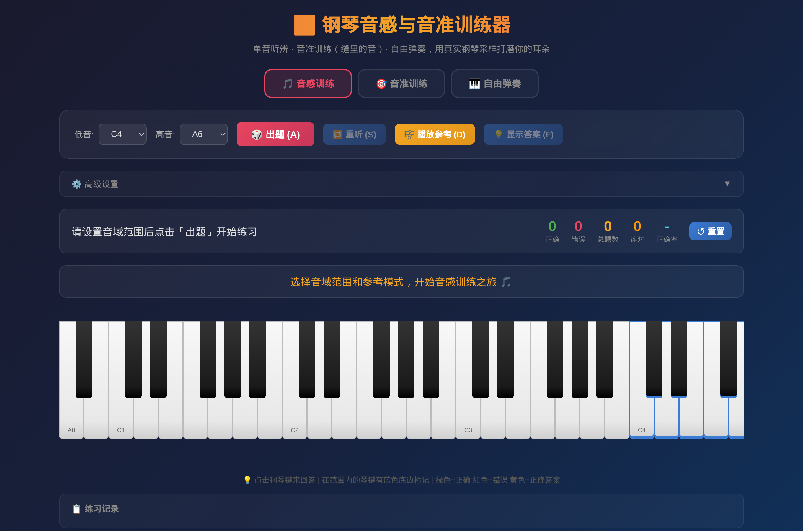
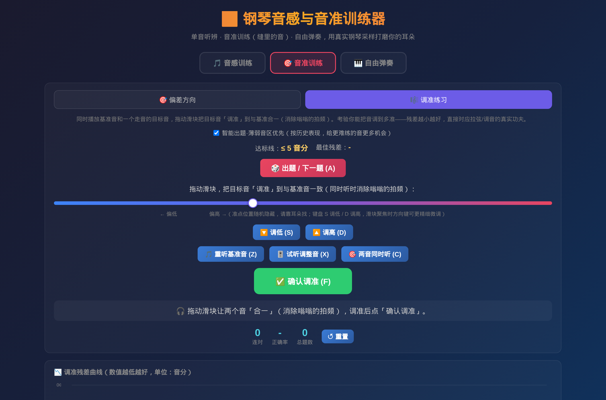

# 🎹 Piano Ear & Intonation Trainer

<p align="center">
  <a href="README.md">简体中文</a> ·
  <b>English</b>
</p>

A web-based piano ear-training tool built on the real Salamander Grand Piano samples. Beyond regular **single-note ear training**, it features dedicated **intonation training** — learning to hear and tune the microtones that fall *between* the piano keys. This is especially useful for players of fretless / continuous-pitch instruments such as violin or erhu who need to polish their intonation.


## 🌐 Live Demo

No installation needed — open and play (static build on GitHub Pages):

**👉 https://qicongxie.github.io/piano-ear-trainer/**

## 📸 Screenshots

These screenshots show the original interface. See the feature guide below for the current exercise menu and landscape keyboard.

| Ear Training | Intonation Training (Tuning) |
|:---:|:---:|
|  |  |

## ✨ Features

Ear Training and Free Play are in the main navigation; Pitch Direction, Tuning, Melody Memory, and Interval Challenge are listed directly in the ear-training mini-games menu. The app includes live stats, progress curves, record export/import, and mobile support. Backups include the Melody Memory best round count. Importing an older backup without that field preserves the existing best.

Pitch Direction and Tuning track accuracy, streaks, and attempts separately and can be reset independently. Older combined totals stay archived; each exercise keeps its existing curve and best result.

The home-screen range applies to every exercise and mini-game, but not Free Play. If an exercise cannot fit in the selected range, it asks you to widen the range instead of playing outside it.

### 🎶 Melody Memory

Open Melody Memory from the ear-training mini-games menu. Listen to a piano phrase, then reproduce it with up to five note buttons, depending on your selected range. Clear a round to add one note, starting at three and ending at eight. Replay as often as you like; your best round count is saved in this browser separately from your other practice stats.

### 🎼 Interval Challenge

Listen to two piano notes and identify their interval over five questions. The first three intervals ascend; the last two may descend. Replay any question and see the note names, semitone count, and an explanation after answering.

### 🎵 Ear Training (single-note recognition)

- **Custom range**: set any low/high boundary between A0–C8.
- **Reference modes**: none (pure listening), full chromatic scale, diatonic scale, context window, tonic only, standard A (A4=440Hz), interval reference.
- **Hints**: direction (higher/lower) / interval distance / none; wrong keys are annotated with direction & distance.
- **Velocity**: fixed or random, across 6 layers (pp / p / mp / mf / f / ff).
- **Smart questions**: weak-note first — questions are weighted by each note's historical error rate.
- **Live stats**: correct, wrong, total, streak (with best), accuracy.
- **Progress curve**: cumulative accuracy over time.

### 🎯 Intonation Training (microtones / "between the keys") — the highlight

Detunes the real piano samples by exact **cents** (1 semitone = 100 cents) to train pitch acuity beyond equal temperament. Two sub-modes:

- **Deviation direction**: hear the reference note then the target, decide whether the target is **higher / lower**.
  - Adaptive staircase: starts at 50 cents, **descends quickly** while you're correct, then switches to a **fine search** after your first miss to converge on your discrimination limit.
  - Reaches down to **2 cents** (well beyond typical human limits); the sub-5-cent tiers require **more consecutive correct answers to unlock** (3 / 4 / 5).
- **Tuning practice**: a detuned target note is played against the reference; drag the slider to tune it into unison.
  - Scored by **residual error (cents)**, pass line ≤ 5 cents; the "in-tune" slider position is randomly hidden each round to prevent visual cheating.
  - Independent auditions: replay reference / preview adjusted note / play both together (to hear beats & consonance).
- **Weak-region weighting** (optional, on by default): weights questions by each region's history (error rate / average residual) to focus on your weak spots.
- **Score curves**: discrimination-threshold curve / tuning-residual curve — lower is better, with your best marked.

### 🎹 Free Play

A virtual 88-key piano playable by mouse, touch, or computer keyboard. The computer keyboard covers 34 consecutive pitches (C4–A6 by default), so you can play chords across octaves without switching. Shift the entire range with `[` / `]` or the on-screen arrows. Mouse and touch can still play all 88 keys.

On a phone, open Free Play and turn it sideways. The keyboard expands automatically on touch devices in shorter landscape layouts; in portrait you can also tap the expand button. Swipe or use the arrows to scroll an octave at a time. Scrolling moves the view without changing the pitch of the computer keyboard mapping. Use Exit to return to the regular view; it stays closed until you rotate again.

### 🧰 General

- **Real piano timbre**: high-quality Salamander Grand Piano V3 samples, velocity-layered and lazy-loaded.
- **Persistence + export/import**: all settings, stats, weak-note distribution and progress curves are saved in the browser; export to JSON and import on another computer to keep your targeted practice.
- **Mobile-friendly**: responsive layout (the piano scrolls horizontally on phones).
- **Keyboard shortcuts**: press `A` for a new question in Ear Training or Intonation. See the other modes below.

## ⌨️ Keyboard Shortcuts

| Mode | Keys |
|---|---|
| Ear Training | `A` new · `S` replay · `D` play reference · `F` reveal answer |
| Intonation · Direction | `A` new · `S` replay · `D` higher · `F` lower |
| Intonation · Tuning | `A` new · `S` tune down · `D` tune up · `F` confirm · `Z` replay reference · `X` preview adjusted · `C` play both |
| Free Play | Lower range: `Z X C V B N M , . /` (white), `S D G H J L ;` (black). Upper: `Q W E R T Y U I O P` (white), `2 3 4 6 7 9 0` (black). Shift range with `[` / `]`. |
| Melody Memory | `1`–`5` play the corresponding note |
| Interval Challenge | `1`–`4` select an answer |

## 🚀 Local Setup

### Preview the GitHub Pages build locally

From the repository root, run the following command, then open [http://127.0.0.1:7860/](http://127.0.0.1:7860/):

```bash
python3 -m http.server 7860 --bind 127.0.0.1 --directory docs
```

GitHub Pages serves the same front end and MP3 samples from `docs/`; no Flask or audio conversion is needed. The online and local versions store progress separately. Export and import a JSON backup when switching addresses, ports, browsers, or devices.

### Local Flask build

Use the Flask build if you need custom samples or startup settings:

#### Requirements

- **Python 3.6+**
- **Flask** — web framework
- **ffmpeg** — audio conversion
- **Git LFS** — large sample assets

```bash
# Ubuntu / Debian
sudo apt install ffmpeg git-lfs
# macOS
brew install ffmpeg git-lfs
# Initialize Git LFS (first time only)
git lfs install
```

#### Quick Start

```bash
# 1. Clone
git clone git@github.com:QicongXie/piano-ear-trainer.git
cd piano-ear-trainer

# 2. One-step setup (pull LFS samples → extract → install deps → preprocess audio)
bash setup.sh

# 3. Run
bash run.sh
```

The service runs in the background. Open [http://127.0.0.1:7860/](http://127.0.0.1:7860/) in your browser. To limit access to your own computer, start it with `HOST=127.0.0.1 bash run.sh`.

### Configuration (environment variables)

| Variable | Default | Description |
|---------|--------|------|
| `HOST` | `0.0.0.0` | Bind address |
| `PORT` | `7860` | Port |
| `DEBUG` | `false` | Debug mode |
| `AUDIO_FORMAT` | `mp3` | Audio format (mp3 / wav) |
| `VELOCITY_LAYERS` | `pp p mp mf f ff` | Velocity layers (space-separated) |
| `DEFAULT_LOW_NOTE` | `C4` | Default range lower bound |
| `DEFAULT_HIGH_NOTE` | `A6` | Default range upper bound |

```bash
# wav format + custom port
AUDIO_FORMAT=wav PORT=8080 bash run.sh

# single velocity layer (save disk space)
VELOCITY_LAYERS="mf" bash setup.sh && bash run.sh
```

### Stop / Logs

```bash
kill PID         # replace PID with the process ID printed by run.sh
tail -f app.log  # logs
```

If the port is already in use, the script exits without stopping the other process. Try `PORT=7861 bash run.sh` to use a different port.

## 🛠️ Development & Static Deployment

**Only `templates/index.html` (the Flask template) is hand-maintained.** The `docs/index.html` used by GitHub Pages / EdgeOne is a **static build artifact** generated by `build-docs.js` (it hardcodes the config placeholders and rewrites sample paths to relative). **Do not edit `docs/index.html` by hand.**

### Generate the static build

```bash
node build-docs.js   # generate docs/index.html from templates/index.html
```

### Auto-sync (install the git hook once)

With the pre-commit hook installed, any commit touching `templates/index.html` regenerates `docs/index.html` and stages it automatically:

```bash
cp scripts/git-hooks/pre-commit .git/hooks/pre-commit && chmod +x .git/hooks/pre-commit
```

> The audio samples in `docs/samples/` are not managed by the script and are always kept in the repo.

### Deploy to GitHub Pages

`docs/` already contains the generated page and samples. In **Settings → Pages → Deploy from a branch**, choose the publishing branch and `/docs` folder (the upstream repository uses `main`). No additional build is needed; local changes do not appear online until that branch deploys.

### Deploy to EdgeOne Pages

Since `docs/index.html` is committed as a finished artifact, deploy it as a static site with no build environment:

1. EdgeOne console → **Pages → Import Git repository**, authorize and pick this repo;
2. Build settings: leave the **build command empty**, set the **output/root directory to `docs`**, framework preset **None / Static**;
3. Access via the default domain, or bind your own (custom domains in mainland China require ICP filing).

> After changing `templates/index.html`, regenerate and commit `docs/index.html` first (the pre-commit hook does this automatically); EdgeOne redeploys on the next push.

## 📁 Project Structure

```
piano-ear-trainer/
├── app.py                  # Flask backend
├── prepare_samples.py      # sample preprocessing
├── build-docs.js           # builds the static docs from templates
├── run.sh                  # start script (nohup background)
├── setup.sh                # one-step setup (LFS pull + extract + preprocess)
├── scripts/
│   └── git-hooks/
│       └── pre-commit      # git hook that rebuilds docs/index.html on commit
├── templates/
│   └── index.html          # frontend (local Flask version; the only hand-edited source)
├── docs/                   # GitHub Pages / EdgeOne static build (samples + screenshots)
│   ├── index.html          # [generated] built from templates by build-docs.js
│   ├── samples/            # audio samples for the static site
│   ├── screenshot-desktop-practice.png         # Practice and exercise menu
│   └── screenshot-mobile-landscape-freeplay.png # Expanded keyboard
├── static/
│   └── samples/            # [generated] preprocessed samples for local version
├── SalamanderGrandPianoV3+20161209_48khz24bit.tar  # [LFS] raw sample pack
├── README.md               # Chinese docs (default)
├── README.en.md            # English docs
├── .gitattributes          # Git LFS config
└── .gitignore
```

> `[LFS]` files are managed by Git LFS; `[generated]` directories are produced by scripts.

## 🎵 Velocity Layers

The original Salamander pack has 16 velocity levels (v1–v16), mapped here to 6 common layers:

| Layer | Meaning | Original range | Representative |
|--------|------|------------|---------|
| pp | pianissimo | v1–v3 | v2 |
| p | piano | v4–v6 | v5 |
| mp | mezzo-piano | v7–v8 | v8 |
| mf | mezzo-forte | v9–v10 | v10 |
| f | forte | v11–v13 | v12 |
| ff | fortissimo | v14–v16 | v15 |

## 🎼 Sample Source

[Salamander Grand Piano V3](https://freepats.zenvoid.org/Piano/acoustic-grand-piano.html) — free piano samples recorded by Alexander Holm, 48kHz / 24bit.
