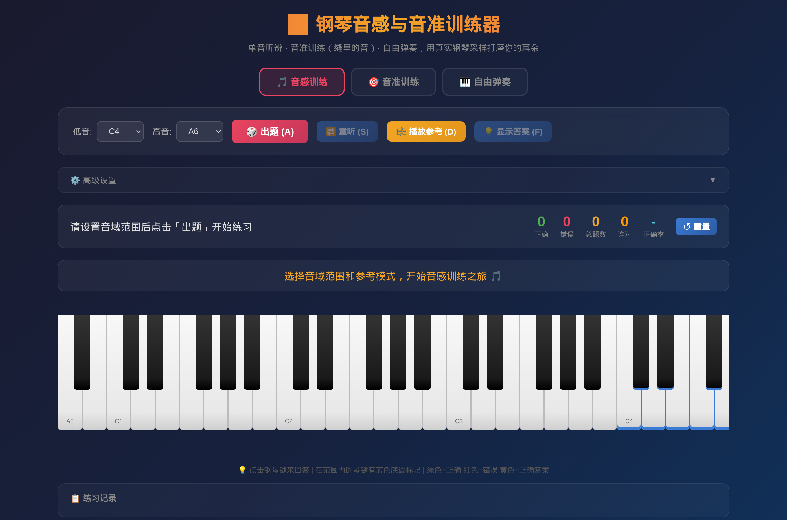

# 🎹 钢琴音感与音准训练器（Piano Ear & Intonation Trainer）

<p align="center">
  <b>简体中文</b> ·
  <a href="README.en.md">English</a>
</p>

基于 Web 的钢琴听觉训练工具，使用 Salamander Grand Piano 真实钢琴采样。除了常规的**单音听辨**，还专门加入了**音准（intonation）训练**——训练你辨别与调准落在钢琴琴键「缝隙」之间的微分音（microtone），特别适合小提琴、二胡等无品/连续音高乐器的音准打磨。

## 🌐 在线体验

无需安装，打开即用（GitHub Pages 静态版）：

**👉 https://qicongxie.github.io/piano-ear-trainer/**

## 📸 界面预览

| 音感训练 | 音准训练（调准练习） |
|:---:|:---:|
|  |  |

## ✨ 功能总览

工具包含三种模式，配套统计、进步曲线、记录导出/导入与移动端适配。

### 🎵 音感训练（单音听辨）

- **自定义音域**：在 A0–C8 之间任意设定低音/高音边界。
- **多种参考模式**：无参考（纯听音）、完整半音阶、自然音阶、上下文窗口、仅主音、标准 A（A4=440Hz）、音程参考。
- **提示方式**：高低方向 / 音程距离 / 不提示；答错时在错键上直观标注方向与距离。
- **力度控制**：固定或随机力度，共 6 层（pp / p / mp / mf / f / ff）。
- **智能出题**：薄弱音优先——按每个音的历史错误率加权出题，哪儿弱练哪儿。
- **实时统计**：正确、错误、总题数、连对（含历史最高）、正确率。
- **进步曲线**：累计正确率随练习变化的折线图。

### 🎯 音准训练（微分音 / “缝里的音”）—— 核心特色

以精确的音分（cent，1 个半音 = 100 音分）偏移真实钢琴采样，训练超越平均律的听觉精度。含两个子模式：

- **偏差方向**：先后播放基准音与目标音，判断目标「偏高 / 偏低」。
  - 自适应阶梯：起始 50 音分，答对时**快速下探**，首次答错后转入**精细搜索**逼近你的听辨极限。
  - 难度可达 **2 音分**（远超常人极限）；**5 音分以下的进阶档需要更多连对才能解锁**（3 / 4 / 5 次）。
- **调准练习**：同时/先后播放基准音与一个走音的目标音，拖动滑块把目标音「调准」到与基准合一。
  - 按 **残差**（音分）评分，达标线 ≤ 5 音分；「准点」位置每题随机隐藏，杜绝视觉作弊。
  - 独立试听：重听基准音 / 试听调整音 / 两音同时听（听拍频与和谐度）。
- **薄弱音区加权出题**（可选，默认开）：按各音区历史表现（错误率 / 平均残差）加权，重点强化难练的音区。
- **成绩曲线**：听辨阈值曲线 / 调准残差曲线，数值越低越好，并标注历史最佳。

### 🎹 自由弹奏

虚拟 88 键钢琴，支持鼠标点击与电脑键盘弹奏，可切换八度，随意发挥。

### 🧰 通用能力

- **真实钢琴音色**：基于 Salamander Grand Piano V3 高品质采样，按力度分层、按需懒加载。
- **记录持久化 + 导出/导入**：所有设置、统计、薄弱音分布、进步曲线自动存于浏览器；可一键导出为 JSON，换台电脑导入后继续针对性练习。
- **移动端适配**：响应式布局，手机上同样可用（钢琴可横向滑动查看）。
- **键盘快捷键**：各模式统一以 `A` 出题，主功能键沿用 `A/S/D/F`（详见下表）。

## ⌨️ 键盘快捷键

| 模式 | 按键 |
|---|---|
| 音感训练 | `A` 出题 · `S` 重听 · `D` 播放参考 · `F` 显示答案 |
| 音准 · 偏差方向 | `A` 出题 · `S` 重听 · `D` 偏高 · `F` 偏低 |
| 音准 · 调准练习 | `A` 出题 · `S` 调低 · `D` 调高 · `F` 确认 · `Z` 重听基准音 · `X` 试听调整音 · `C` 两音同时听 |
| 自由弹奏 | 白键 `A S D F G H J K` → C D E F G A B C；黑键 `W E T Y U`；`Z`/`X` 切换八度 |

## 🚀 本地部署

在线版已可直接使用；若需本地运行完整版（含 Flask 后端与自定义采样）：

### 依赖要求

- **Python 3.6+**
- **Flask**：Web 服务框架
- **ffmpeg**：音频格式转换
- **Git LFS**：管理大型采样资源文件

```bash
# Ubuntu / Debian
sudo apt install ffmpeg git-lfs
# macOS
brew install ffmpeg git-lfs
# 初始化 Git LFS（仅首次）
git lfs install
```

### 快速开始

```bash
# 1. 克隆仓库
git clone git@github.com:QicongXie/piano-ear-trainer.git
cd piano-ear-trainer

# 2. 一键整备（拉取 LFS 采样 → 解压 → 装依赖 → 预处理音频）
bash setup.sh

# 3. 启动服务
bash run.sh
```

服务默认在后台运行，访问地址：`http://0.0.0.0:7860`

### 配置项（环境变量）

| 环境变量 | 默认值 | 说明 |
|---------|--------|------|
| `HOST` | `0.0.0.0` | 监听地址 |
| `PORT` | `7860` | 监听端口 |
| `DEBUG` | `false` | 调试模式 |
| `AUDIO_FORMAT` | `mp3` | 音频格式（mp3 / wav） |
| `VELOCITY_LAYERS` | `pp p mp mf f ff` | 力度层（空格分隔） |
| `DEFAULT_LOW_NOTE` | `C4` | 默认音域下界 |
| `DEFAULT_HIGH_NOTE` | `A6` | 默认音域上界 |

```bash
# 使用 wav 格式 + 自定义端口
AUDIO_FORMAT=wav PORT=8080 bash run.sh

# 仅使用单力度（节省磁盘空间）
VELOCITY_LAYERS="mf" bash setup.sh && bash run.sh
```

### 停止服务 / 查看日志

```bash
# 停止（启动时会提示 PID，或按端口查找）
lsof -i :7860 -t | xargs kill -9
# 日志
tail -f app.log
```

## 📁 项目结构

```
piano-ear-trainer/
├── app.py                  # Flask 后端主程序
├── prepare_samples.py      # 钢琴采样预处理脚本
├── run.sh                  # 服务启动脚本（nohup 后台运行）
├── setup.sh                # 一键整备脚本（LFS 拉取 + 解压 + 预处理）
├── templates/
│   └── index.html          # 前端页面（本地 Flask 版）
├── docs/                   # GitHub Pages 静态版（含采样与截图）
│   ├── index.html          # 静态前端（配置写死，采样相对路径）
│   ├── samples/            # 供静态站使用的音频采样
│   ├── screenshot-main.png # 音感训练截图
│   └── screenshot-pitch.png# 音准训练截图
├── static/
│   └── samples/            # [生成] 本地版预处理后的音频采样
├── SalamanderGrandPianoV3+20161209_48khz24bit.tar  # [LFS] 原始采样包
├── README.md               # 中文说明（默认）
├── README.en.md            # 英文说明
├── .gitattributes          # Git LFS 配置
└── .gitignore
```

> 标注 `[LFS]` 的文件由 Git LFS 管理，标注 `[生成]` 的目录由脚本自动生成。

## 🎵 力度分层方案

原始 Salamander 采样包含 16 级力度（v1–v16），本工具映射为 6 个常用力度级别：

| 力度层 | 含义 | 原始力度范围 | 代表力度 |
|--------|------|------------|---------|
| pp | 极弱 (pianissimo) | v1–v3 | v2 |
| p | 弱 (piano) | v4–v6 | v5 |
| mp | 中弱 (mezzo-piano) | v7–v8 | v8 |
| mf | 中强 (mezzo-forte) | v9–v10 | v10 |
| f | 强 (forte) | v11–v13 | v12 |
| ff | 极强 (fortissimo) | v14–v16 | v15 |

## 🎼 采样来源

[Salamander Grand Piano V3](https://freepats.zenvoid.org/Piano/acoustic-grand-piano.html) — Alexander Holm 录制的免费钢琴采样，48kHz / 24bit 品质。
